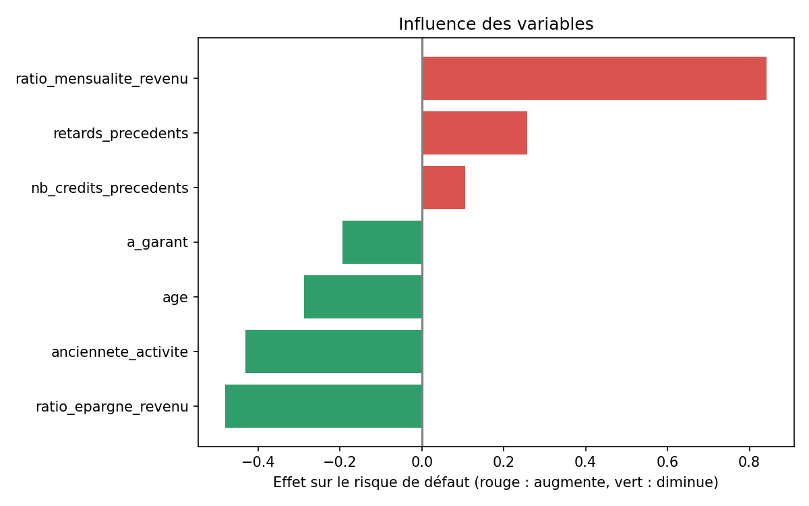

# Score de risque de crédit — Microfinance

Projet de Data Science et d'IA qui estime le risque de défaut d'une demande de crédit et explique le résultat à un conseiller de microfinance. Il prolonge l'idée développée en équipe lors du hackathon CIF 2026 (Score X).

> **Données simulées.** Le jeu de données est généré par `generate_data.py` pour illustrer la méthode. Le projet est éducatif et ne doit pas servir à de vraies décisions de crédit.

## Ce que fait le projet

1. **Génération des données** : 2 000 profils d'emprunteurs fictifs (âge, revenu, ancienneté d'activité, montant, durée, historique de crédit, épargne, garant).
2. **Entraînement** : régression logistique et forêt aléatoire (scikit-learn), évaluées sur 25 % de données de test.
3. **Interface web** : une page où l'on saisit une demande et qui affiche un score sur 100, un niveau de risque, les facteurs qui pèsent dans le résultat et des recommandations.

## Résultats

| Modèle | Précision | AUC |
|---|---|---|
| Régression logistique | 0,874 | 0,776 |
| Forêt aléatoire | 0,874 | 0,769 |

Le taux de défaut est de 13,8 %, donc prédire « jamais de défaut » donnerait déjà 86 % de précision. L'AUC est la mesure la plus utile ici. Le modèle détecte encore mal les défauts (rappel faible au seuil de 0,5) : améliorer ce point est une piste de travail.
Le modèle logistique est retenu pour l'interface, car ses coefficients sont **explicables**, ce qui est essentiel en microfinance.




```

Ouvrir ensuite `index.html` dans un navigateur.

## Structure

```
generate_data.py   données simulées
train_model.py     entraînement, métriques, graphiques, export du modèle
model.js           paramètres du modèle utilisés par la page
index.html, style.css, script.js   interface
data/  results/
```


## Auteure

Fidélia EBA-DOVI, INSTI Lokossa. GitHub : [FideliaEBA](https://github.com/FideliaEBA)
